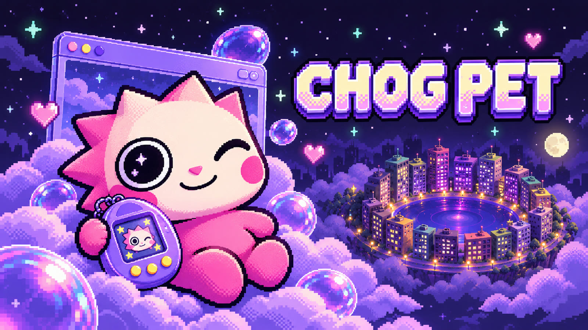
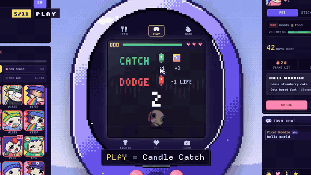
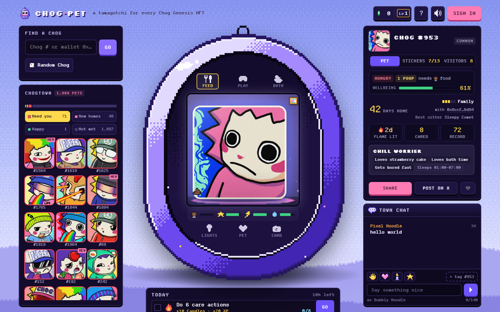
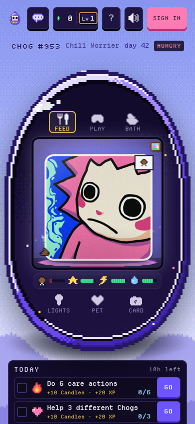
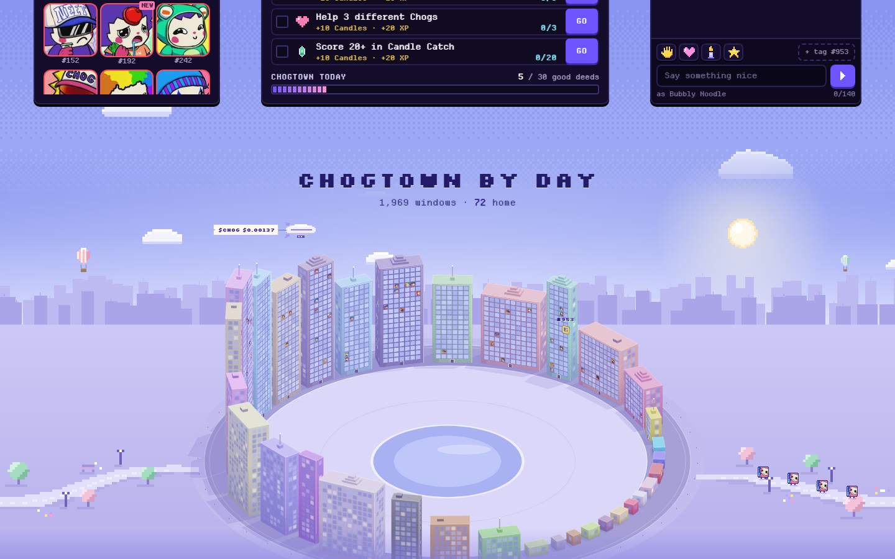

<div align="center">



# Chog Pet

**A shared tamagotchi for every Chog Genesis NFT on Monad.**
Its holder is its home. Anyone can babysit it.

[**▶ Play at chogpet.xyz**](https://chogpet.xyz) &nbsp;·&nbsp; [**🎬 Watch the trailer**](https://www.youtube.com/watch?v=nuLqCMIUBiw) &nbsp;·&nbsp; [How to play](https://chogpet.xyz/guide.html) &nbsp;·&nbsp; Built for **Chogathon 2026**


</div>

---

## What it is

All 1,969 Chog Genesis NFTs live in **Chogtown** as pixel pets. Each Chog is **one pet shared by everyone**: food, fun, energy and clean run down in real time, and whoever drops by can help. Leave a Chog alone too long and it gets sad, then wanders off for snacks until someone feeds it back home.

A wallet is optional: play right away, or sign in through **Privy** with a wallet, X, Google or email (a free signature, no gas). Nothing is bought or sent on-chain.

<p align="center">
  
</p>

## How to play

| | |
|---|---|
| 🔍 **Find a Chog** | Type its number, roll a random one, or pick from Chogtown: *Need you*, *New homes*, *Happy*. |
| 🍰 **Feed** | Every Chog has a favourite food, marked with a ★. |
| 🎮 **Play** | **Candle Catch** on the pet's own screen: green candles and coins in, red candles out, ×2 combo after 5 in a row. |
| 🛁 **Bath** · 💡 **Lights** | Keep it clean, tuck it in. Asleep means **night** over the city ring, awake means **day**. |
| 🕯️ **Candles & XP** | Every kind act pays Candles and sitter XP. Three quests a day, a daily wheel spin, Capsules, Green or Red, a shop. |
| 🎆 **Festival day** | When the whole town hits its daily goal: fireworks over Chogtown and a sticker for every Chog cared for. |

## For holders

The holder is read **live** from the Chog Genesis contract (`ownerOf` on Monad), so there is nothing to register.

- Name your Chog and earn **×1.5 XP** caring for it at home.
- Grow a bond: **Friend → Best friend → Soulmate**.
- Come back to a **Welcome home** note: who looked after it while you were away, and its best sitter.
- Sold it? Its old life moves to *past homes* and it starts fresh with the new holder.
- Hold **$CHOG**? A special $CHOG treat unlocks (a balance check, no transaction).

<p align="center">
  
  &nbsp;
  
</p>
<p align="center">
  
</p>

## Fair by design

All rewards are decided on the server, so a modified client can't farm them.

- Daily caps on XP and Candles, and diminishing returns for the same Chog on the same day (helping many Chogs beats grinding one).
- Cooldowns on every act, claimed atomically and shared per network; one wheel spin per network per day.
- Candle Catch scores need an **HMAC-signed play ticket** and must fit the time actually played.
- Per-IP rate limit on every write, versioned pet rows (no lost updates), a chat filter against impersonation.
- Sign-in is a free **EIP-191 signature**: no transaction, no gas.

## Under the hood

```
public/            static site, no framework, no build step
  js/sim.js        life sim: needs, sleep schedule, poop, running away   ┐ shared by the
  js/persona.js    traits → personality, favourite food, bedtime, lines  │ browser and
  js/econ.js       Candles / XP rules, caps, levels, bond tiers          ┘ the worker
  js/screen.js     128×128 LCD renderer      js/game.js   Candle Catch
  js/skyline.js    the Chogtown city ring    js/card.js   1200×630 share card
worker/
  index.js         API on Cloudflare D1, live ownerOf over Monad RPC, sign-in, town map
  econ.js          server-side economy: tickets, caps, quests, festival
  chat.js          town chat
privy/             Privy login bridge (wallet, X, Google, email), built into public/js/privy/
tools/             data + sprite-atlas builders, headless checks
```

**Stack:** Cloudflare Workers + D1 (SQLite) · vanilla JS + Canvas pixel rendering · Monad mainnet RPC (`ownerOf`, ERC-20 `balanceOf`) · Privy · `@noble/curves` for signature checks · fonts: Silkscreen, Departure Mono.

## Run it locally

```bash
npm install
cd privy && npm install --legacy-peer-deps && npm run build && cd ..   # optional: Privy login
echo "DEV=1" > .dev.vars
npm run dev                     # http://127.0.0.1:8790/?chog=953
```

Tables are created on first request; the local database lives in `.wrangler/state`.
For your own deploy: `wrangler d1 create chog-pet`, put the id in `wrangler.jsonc`, `wrangler secret put SECRET`, then `npm run deploy`.
`OPENSEA_KEY` (optional) adds collection stats to the town banner.

---

<sub>Made by [@exitliqfun](https://x.com/exitliqfun) · tremolyoung@gmail.com<br>Independent fan project, not affiliated with Chog or Monad. Chog Genesis art belongs to its creators and holders.</sub>
